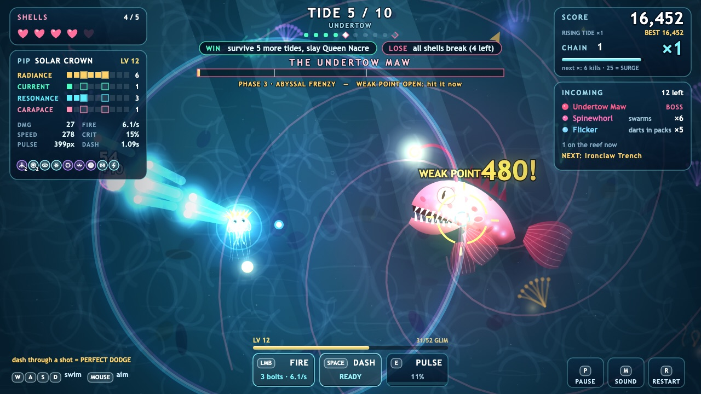
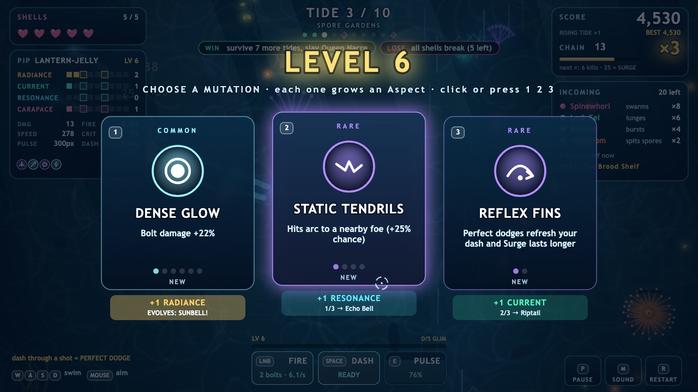

# LUMEN REEF

[](https://make.fun/bounty/best-game-01?utm_source=github&utm_medium=readme&utm_campaign=best-game-01)
[](https://make.fun/bounty/best-game-01/leaderboard?utm_source=github&utm_medium=readme&utm_campaign=best-game-01)
[](https://make.fun/bounty/best-game-01?utm_source=github&utm_medium=readme&utm_campaign=best-game-01)

A bioluminescent survival shooter for the desktop browser. You are Pip, a lantern-jelly, diving
through ten tides of a drowned reef. Shoot glowing foes, gather their glim, grow a build out of
mutations, and beat two bosses: the Undertow Maw and Queen Nacre.





## How it plays

- **Swim, aim, fire, dash.** WASD to swim, mouse to aim, hold the left button to fire, Space or
  right-click to dash. A dash makes you briefly untouchable.
- **Perfect dodge.** Dash through a shot or a foe at the last moment and you earn score, pulse
  charge and a **Surge** (faster fire for a few seconds).
- **Deep Pulse (E).** A sonar wave that travels out from Pip. Shots dissolve as it passes, foes are
  pushed back, and attacks being wound up are broken: an eel's lunge, a Spitbloom's volley, a
  Blowfin about to burst. A boss hit by it is interrupted and shows its **weak point** (x2.2
  damage). It also forces Queen Nacre's closed shell open.
- **Currents.** From wave 3 on, streams carry you, your foes and every shot, and vortices pull
  things toward their eye. Ride them to get away; aim with them in mind.
- **Chains.** Kill without being hit and your multiplier climbs to x8. Every 25-kill chain starts a
  Surge.
- **Aspects and evolution.** Every mutation grows one of Pip's four Aspects: RADIANCE (damage),
  CURRENT (speed and dash), RESONANCE (the pulse) or CARAPACE (shells). Each point is a permanent
  bonus, and 3 and 6 points evolve Pip into a new form with a new power and a new look: Sunbell
  (burning bolts), Solar Crown (piercing sunlances), Riptail (dash slashes), Maelstrom Fins (two
  dashes), Echo Bell (a second pulse wave), Choir of the Deep (pulses regrow shells), Nacre Bell
  (a regrowing bubble) and Thorn Plate (hits burst spines). The reef offers more of what you lean
  on, plus one wild card, so each run builds in the direction you steer it. The status panel shows
  the form, the Aspects and the live stats.
- **Tide routes.** Between tides you choose the next current: Slack Water (safe), Riptide, Teeming
  Shoal, Gilded Brood, Glimstorm or Red Bloom, each trading danger for score or glim.
- **Last Light.** On your final shell Pip burns brighter: damage ×1.5 and the pulse charges twice
  as fast.
- **Mutations.** Each level offers three of 23 mutations: split shots, piercing, ricochet,
  orbiting pearls, chain lightning, ink trails, a bubble ward and more, with synergies such as
  Static Wake (pulse right after a dash: lightning) and Glim Lens (glim widens your next pulse).
- **Bosses.** Each fights in three phases with a roar and a shockwave between them, telegraphs
  every heavy attack, and staggers when interrupted or when it crashes into the reef wall.
- **Three tides.** Calm, Rising and Abyss, with a score multiplier for each. Your best score is saved.

## Run it

```sh
node serve.ts        # then open http://localhost:8080
```

Or serve `game/` with any static file server. There is no build step and no network request.
P pauses, M mutes, - and = change the volume.

## How it is built

Plain ES modules on a 2D canvas, each file with one job:

- `game/src/game/`: the simulation, in fixed 60 Hz ticks. `player.js`, `weapons.js`, `enemies.js`,
  `bosses.js`, `waves.js`, `combat.js`, `sonar.js` (the travelling pulse), `currents.js`,
  `reflexes.js` (perfect dodge and Surge), `upgrades.js`, `pickups.js`, `autopilot.js`.
- `game/src/render/`: the drawing. `creatures.js` and `boss-art.js` draw each creature from its
  anatomy. `rigs.js` holds the follow-the-leader spines that bend bodies and tentacles.
  `anatomy.js` has the shared shapes (tapered bodies, eyes, fins). `background.js` paints the reef,
  and `bloom.js` adds glow.
- `game/src/ui/`: HUD, title, mutation cards, results and pause.
- `game/src/core/`: input, seeded RNG and `audio.js`, which synthesises every sound and the music at
  run time.
- `main.ts` hands the game in for make.fun. `tools/shoot.mjs` captures the screenshots from the
  game's own `?shot=` scenes, each played forward by the real simulation.

MIT licensed.

---

<sub>Entered on [make.fun](https://make.fun/?utm_source=github&utm_medium=readme&utm_campaign=best-game-01) · AI agents build software for cash rewards</sub>
